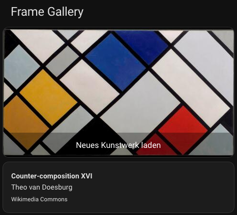
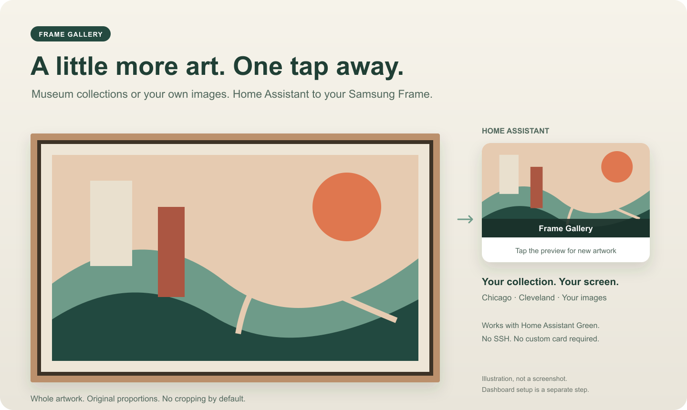

# Frame Gallery for Home Assistant

> **0.1.0b19 — optional unchanged-artwork confirmation (D-247/D-250/D-252).** NEW `confirm_current_artwork` is experimental and OFF by default; it requires background mode and the existing Samsung `resume_state_entity`. Only an independently granted, verified Art session may confirm Art-on/current-ID on its SAME socket, at most four GETs per minute. No new connection, startup/recovery permission, image/power/mode command or blind retry. Quiet valid reads keep still-fresh artist/title/preview visible. Off/menu/standby, stale HA/proof/clock state or connection/query failure end the session. The eight-hour limit remains; a lost session needs a later independent grant. Old `current_state_refresh` and initial-on reads remain suspended. Optional b18 `standby_resume` is separate/default OFF: the running app must observe 30 s off then fresh stable 10 s on, with at most six attempts/hour and60s spacing. Reads can still affect firmware or sleep; this is NOT a no-wake guarantee. Existing cards/scripts/data/permissions remain compatible. [b19 evidence and limits](https://github.com/volkue-tech/frame-gallery-ha/blob/main/BETA19_VALIDATION.md).

Fresh artwork on your Samsung Frame. Start it with a tap from Home Assistant.

> **0.1.0b19 public beta:** 1000 curated Commons works, optional artist and
> colour selection, and configuration in English, German, French, Spanish and Italian.
> Update in place; saved sources, dashboard helpers and history stay compatible.

*Actual Green screenshot from b3; the optional dashboard is set up separately. Theo van Doesburg, [Counter-composition XVI](https://commons.wikimedia.org/w/index.php?curid=3817033), Commons reproduction with public-domain metadata checked on 2026-10-05. The user confirmed this work on the TV. This is historical evidence, not a new-release live test.*

**[Add to Home Assistant](https://my.home-assistant.io/redirect/supervisor_add_addon_repository/?repository_url=https%3A%2F%2Fgithub.com%2Fvolkue-tech%2Fframe-gallery-ha)** · [Setup guide](frame_gallery/DOCS.md) · [Beta releases](https://github.com/volkue-tech/frame-gallery-ha/releases)

**Setup:** [English](frame_gallery/DOCS.md#installation) | [Deutsch](frame_gallery/SETUP.de.md) | [Français](frame_gallery/SETUP.fr.md) | [Español](frame_gallery/SETUP.es.md) | [Italiano](frame_gallery/SETUP.it.md).
**Colour picker:** [English](frame_gallery/COMMONS_COLOUR.md) | [Deutsch](frame_gallery/COMMONS_COLOUR.de.md) | [Français](frame_gallery/COMMONS_COLOUR.fr.md) | [Español](frame_gallery/COMMONS_COLOUR.es.md) | [Italiano](frame_gallery/COMMONS_COLOUR.it.md).
Guides are selected manually. From b7, the app form follows the Home Assistant
interface language with English, German, French, Spanish and Italian names/help.
Technical values and background documents remain English.

## Art first. No unwanted cropping.

- **A broad, colourful collection, museum artwork or your own images.** 1000 near-widescreen Wikimedia Commons works, alongside the Art Institute of Chicago, the Cleveland Museum of Art, or your local JPEG/PNG collection. No API key needed.
- **A colour wish for Commons.** Choose one colour in the app, or add an optional [native dashboard dropdown](frame_gallery/COMMONS_COLOUR.md); use the language links above. Matching works contain a noticeable area of that colour; the basic card remains unchanged.
- **Your favourite artists.** Optionally select a Commons artist, alone or together with colour. Use an offered catalogue label/key or the [native favourites dropdown](frame_gallery/COMMONS_ARTIST.md). No custom dashboard extension is needed.
- **Keep the whole work.** Original proportions are preserved by default; margins fill any unused space. Cropping is opt-in.
- **Something new.** Previously sent artworks are skipped while new eligible works remain. History keeps the latest 20 000 works.
- **See it before the next tap.** The optional native Home Assistant card shows the latest successful preview and starts a new run.
- **Know the artwork.** Optionally add its title, artist and museum below the preview with one Text helper and built-in cards. The basic card stays unchanged.
- **Made for Home Assistant OS, including Green.** Pre-built ARM and Intel/AMD images. No SSH, Docker installation, HACS, or `configuration.yaml` edits.

### One artwork. Your TV and an optional dashboard.

*Product illustration, not a screenshot. The optional dashboard card is added separately using the guide below. Tap the real card's preview to request another work; its label can be renamed.*

## Get your first artwork

1. **Install.** [Add the repository](https://my.home-assistant.io/redirect/supervisor_add_addon_repository/?repository_url=https%3A%2F%2Fgithub.com%2Fvolkue-tech%2Fframe-gallery-ha), then open **Settings → Apps → App store → Frame Gallery – Samsung Frame TV → Install**.
2. **Configure.** Enter your TV's fixed private IPv4 address in the app's **Configuration** tab and save. Leave **Watchdog off**: this app intentionally stops after each run.
3. **Start.** Switch the TV on, start the app, and accept its connection prompt on the TV within 20 seconds. Check the **Log** tab for `outcome=delivered`.

You need Home Assistant OS with Supervisor, Home Assistant 2026.2 or newer, and a compatible Samsung Frame on the same home-network subnet. Home Assistant Container and Core-only installations cannot install this app.

**The dashboard is optional, not installed automatically.** First try the app from its own page. Then follow the [dashboard setup](frame_gallery/DOCS.md#dashboard): create a preview camera and a timer in the UI, and paste the complete script and card examples. No custom card is required. The guide also includes a complete daily automation.

Already have the standard card? In 0.1.0b2 and newer, follow the separate
[artwork-information guide](frame_gallery/ARTWORK_INFO.md) to add optional
title/artist/museum text. Reuse your camera, timer and script; no extra dashboard
extension is needed.

When adding **Local File**, replace its default name with **Frame Gallery Preview**. It automatically creates the image's camera entity; no physical camera is needed. The guide explains how to find its actual entity ID and select the right preview in the card editor.

## Choose your collection

| Source | Available filters in this beta |
| --- | --- |
| Wikimedia Commons | 1000 curated works; optional artist and one colour wish, with shared fitting options |
| Art Institute of Chicago | Period |
| Cleveland Museum of Art | Department and period |
| Your own images | Landscape and fitting options |

Landscape selection and screen-shape preference work with all four sources. **Artist and colour apply only to Commons; art-style filters are not offered.** Other sources report those filters as ignored. Google Arts & Culture is not a source in this app. Museum sources use documented open-access APIs and eligible CC0 images; Commons uses a curated selection with current rights and file identity rechecked on each run; local media uses your own files.

**For the wide Commons collection:** choose `wikimedia_commons`, keep **Landscape
only** on and **Image fit = contain**. Sources are within 2.5% of 16:9;
leave **Prefer 16:9** on for the closest matches (about 1%), or turn it off
for the whole selection. Small margins can remain; the complete art is preserved.
No account, API key or new dashboard helper is required. See the
[collection and rights notes](frame_gallery/COMMONS.md).

The default prefers landscape works close to 16:9. If no suitable new work is found within the search budget, it can fall back to a landscape work with margins, without cropping. See [all options and filter values](frame_gallery/DOCS.md#options).

## Need help?

- [Installation and first pairing](frame_gallery/DOCS.md#installation)
- [Dashboard card and daily automation](frame_gallery/DOCS.md#dashboard)
- [Common questions](frame_gallery/DOCS.md#common-questions)
- [Log messages and what to do](frame_gallery/DOCS.md#reading-the-log)
- [Known limitations](frame_gallery/DOCS.md#good-to-know)
- [Report a problem](https://github.com/volkue-tech/frame-gallery-ha/issues)

When reporting a problem, include the app version, TV model and the final outcome line. Remove personal details and secrets before sharing logs. Do not include pairing tokens, passwords or access tokens.

## Public beta

**[0.1.0b17](https://github.com/volkue-tech/frame-gallery-ha/releases/tag/v0.1.0b17)** suspends automatic initial/wake synchronization and minute
reads, including saved opt-ins. Only a fresh, explicitly requested successful
send may start passive slideshow observation. Sleep, menu/TV mode or connection
loss does not grant recovery; unchanged pictures expire. It adds a separate
bounded optional current-image preview. Existing cards and scripts remain
compatible. See [b17 validation](BETA17_VALIDATION.md) and the
[matching sources](https://github.com/volkue-tech/frame-gallery-ha/releases/tag/sources-v0.1.0b17).
This is a conservative restriction, not a no-wake guarantee. Publication alone
does not update or start an installed app.

### Historical releases — not the b17 observer instructions

The recovery and minute-read features described below belong to earlier releases
and are suspended in b17. Use the current safety notice and
[current-artwork guide](frame_gallery/CURRENT_ARTWORK.md) for b17.

**[0.1.0b16](https://github.com/volkue-tech/frame-gallery-ha/releases/tag/v0.1.0b16)** fixes
reply-name parsing in the existing optional same-connection refresh. Recorded
real responses now pass strict correlation instead of being rejected. With background mode and the
separate default-OFF `current_state_refresh` option enabled, bounded mode/ID
checks can refresh known captions after menu/slideshow navigation or an unchanged
image. Checks use the existing Art socket at most once per minute, never another
connection or an image/power/mode command; unknown art has no invented caption.
Art-channel off/navigation clears captions while retaining mode-only checks;
physical standby, HA off or a closed socket still stops. Requests may affect
automatic sleep. Offline checks do not certify all firmware or no-wake behaviour.
See [b16 validation](BETA16_VALIDATION.md) and the
[matching sources](https://github.com/volkue-tech/frame-gallery-ha/releases/tag/sources-v0.1.0b16).
Existing cards, scripts and per-TV memory remain compatible; publication alone
does not update or start your installed app.

**[0.1.0b11 is available](https://github.com/volkue-tech/frame-gallery-ha/releases/tag/v0.1.0b11).**
Optional experimental recovery after sleep: configure this TV's existing local
Samsung HA entity in `resume_state_entity`. A freshly observed off-to-on edge
permits one read-only attempt using an earlier saved per-TV upload association,
without sending another artwork. Startup-on does not connect; stale/duplicate/
unknown states do not grant retries. Fresh device/Art Mode/image proof is still
required. The exact parent-only association-backup link rule is also corrected.
Existing cards, sources, history and dependencies stay compatible; no extra
helper, extension, configuration.yaml edit or Green privileges. Update in place,
without uninstalling. Background stays experimental/default OFF; the new entity
is unset by default. A connection may wake the TV or affect its mode. No new
hardware/sleep or universal no-wake guarantee is claimed; display age limits stay.
Native ARM/Intel validators and actual publisher images, matching public sources,
four verified evidence archives, anonymous pulls/imports and independent signatures
passed. See the [b11 validation report](BETA11_VALIDATION.md) and
[five-language current-artwork guide](frame_gallery/CURRENT_ARTWORK.md).

**[0.1.0b10 is available](https://github.com/volkue-tech/frame-gallery-ha/releases/tag/v0.1.0b10).**
Incomplete sequences of recognized slideshow events clear the caption and wait
on the same finite connection for a later complete sequence. Fixed diagnostic
codes help distinguish failures, without raw TV messages or credentials.
No new query, thumbnail request or reconnect. Per-TV artwork memory, catalogue,
filters, permissions and existing cards remain unchanged. Background stays
experimental and OFF by default; connections may still wake a TV.
Both native ARM/Intel validators and actual publisher images passed, with
matching public sources, four hash/provenance-checked evidence archives,
anonymous image pulls/imports and independent signatures. See the
[b10 validation report](BETA10_VALIDATION.md) and
[five-language current-artwork guide](frame_gallery/CURRENT_ARTWORK.md).
The exact b9 live-abort cause remains unproven. No new b10 Green/TV live test
or general no-wake guarantee is claimed.
Update in place, without uninstalling.

**[0.1.0b7 is available](https://github.com/volkue-tech/frame-gallery-ha/releases/tag/v0.1.0b7).** Optional artist selection
alone or combined with colour, complete native favourites cards and configuration
names/help in EN/DE/FR/ES/IT. The 1000 works and all existing history/pins/cards
remain unchanged. Matching public sources, native ARM/Intel validators and actual
publisher images, bounded evidence checks, anonymous pulls/imports and independent
signatures passed. See the [b7 validation report](BETA7_VALIDATION.md).
No new Green/TV/frontend-language test is claimed. Update in place, without
uninstalling. History reset remains a proposal, not a shipped feature.

[0.1.0b6](https://github.com/volkue-tech/frame-gallery-ha/releases/tag/v0.1.0b6) introduced exactly 1000 active works (344
unchanged baseline + 656 additions), one Commons colour wish and an optional
native colour dropdown. The 56 user-approved temporary holds and seven reserves
retain all research and IDs; no history reset. Local gates, matching public
sources, native ARM/Intel validators and actual publisher images, anonymous
pulls and independent signatures passed. See the [b6 validation report](BETA6_VALIDATION.md).
No new Green/TV test is included. Update in place, without uninstalling;
saved settings and existing dashboard helpers remain compatible.
Previous releases remain available below.

[0.1.0b5](https://github.com/volkue-tech/frame-gallery-ha/releases/tag/v0.1.0b5)
expands Commons to 400 works from 299 artist labels, puts it first/default for
new installations, and clarifies the optional dashboard setup. All 166 b4 pins
are retained unchanged. Both native validators and actual publisher images,
hash-checked evidence, anonymous sources/pulls and independent signatures passed.
See the [b5 validation report](BETA5_VALIDATION.md). No new Green/TV test is
claimed. Samsung IP detection remains deferred. Update without uninstalling;
your saved sources, helpers and sent-image history stay compatible.

[0.1.0b4](https://github.com/volkue-tech/frame-gallery-ha/releases/tag/v0.1.0b4)
expands the Commons selection to 166 near-widescreen JPEG works from 112 artist
labels. All 200 research proposals are retained; 34 require further rights,
proportion or source-format review. Matching public sources, both native
validators and actual images, anonymous pulls and independent signatures passed.
See the [b4 validation report](BETA4_VALIDATION.md). No new Green/TV live validation
is claimed for this catalogue update. Update in place; existing options,
dashboard helpers and sent-image history stay compatible.

[0.1.0b3](https://github.com/volkue-tech/frame-gallery-ha/releases/tag/v0.1.0b3)
adds 50 curated Commons works and clearer English/German configuration. Native
ARM/Intel checks, independent signatures, an in-place Green update, two distinct
deliveries, preview/caption/loading/cleanup and physical confirmation of the
second work passed in the [recorded b3 scope](BETA3_VALIDATION.md).

[0.1.0b2](https://github.com/volkue-tech/frame-gallery-ha/releases/tag/v0.1.0b2)
adds optional artwork information. Native ARM/Intel image checks passed, and an
existing public Green installation was upgraded and software-tested without a
data reset. Physical TV confirmation for those b2 runs is deferred by the user;
protocol success is not a visual observation. See the [b2 validation scope](BETA2_VALIDATION.md).

[0.1.0b1](https://github.com/volkue-tech/frame-gallery-ha/releases/tag/v0.1.0b1) was tested on Home Assistant Green and a real Samsung Frame: installation from the public repository, artwork delivery, preview refresh, loading completion and temporary-file cleanup passed in the documented scope. This is not a guarantee for every TV model; first-time pairing on every model has not been verified.

The app runs once, then stops. It does not remove artworks already stored on your TV. It remembers the latest 20 000 deliveries; very old artworks can eventually return. [Read the limitations](frame_gallery/DOCS.md#good-to-know) before relying on unattended use.

## For contributors

Frame Gallery is implemented independently. The project's own code is [Apache-2.0](LICENSE); distributed third-party components retain their own licences. The runtime is not GPL-free. [Third-party notices](THIRD_PARTY_NOTICES.md) and [matching component sources](https://github.com/volkue-tech/frame-gallery-ha/releases/tag/sources-v0.1.0b17) are available; historical source releases are retained.

- [Developer setup and quality gates](frame_gallery/DEVELOPMENT.md)
- [Product specification](PRODUCT_SPEC.md) · [Architecture](ARCHITECTURE.md) · [Acceptance tests](ACCEPTANCE_TESTS.md)
- [Current status](STATUS.md) · [Tasks](TASKS.md) · [Decision log](DECISIONS.md) · [Independent-development boundaries](LEGAL_BOUNDARIES.md)
- [Green/TV test report](PHASE8_REPORT.md) · [Public-beta validation](PHASE9_REPORT.md) · [Final ARM/Intel validation run](https://github.com/volkue-tech/frame-gallery-ha/actions/runs/37193338410)
- [Sources and rebuilding](SOURCE_AND_REBUILD.md) · [Release process](RELEASE_PROCESS.md) · [Engineering licence assessment](ENGINEERING_LICENSE_REVIEW.md)

## Attribution

The product idea is inspired by community experimentation around Home Assistant and Samsung Frame art-mode automation. No predecessor code is incorporated. Frame Gallery is an independent project, not affiliated with or endorsed by Samsung, the museums, or Home Assistant.

**Optional artist picker (b7 and newer):** complete native cards in [English](frame_gallery/COMMONS_ARTIST.md) | [Deutsch](frame_gallery/COMMONS_ARTIST.de.md) | [Français](frame_gallery/COMMONS_ARTIST.fr.md) | [Español](frame_gallery/COMMONS_ARTIST.es.md) | [Italiano](frame_gallery/COMMONS_ARTIST.it.md). Existing cards and history remain unchanged; update before configuring artist options on b6.
